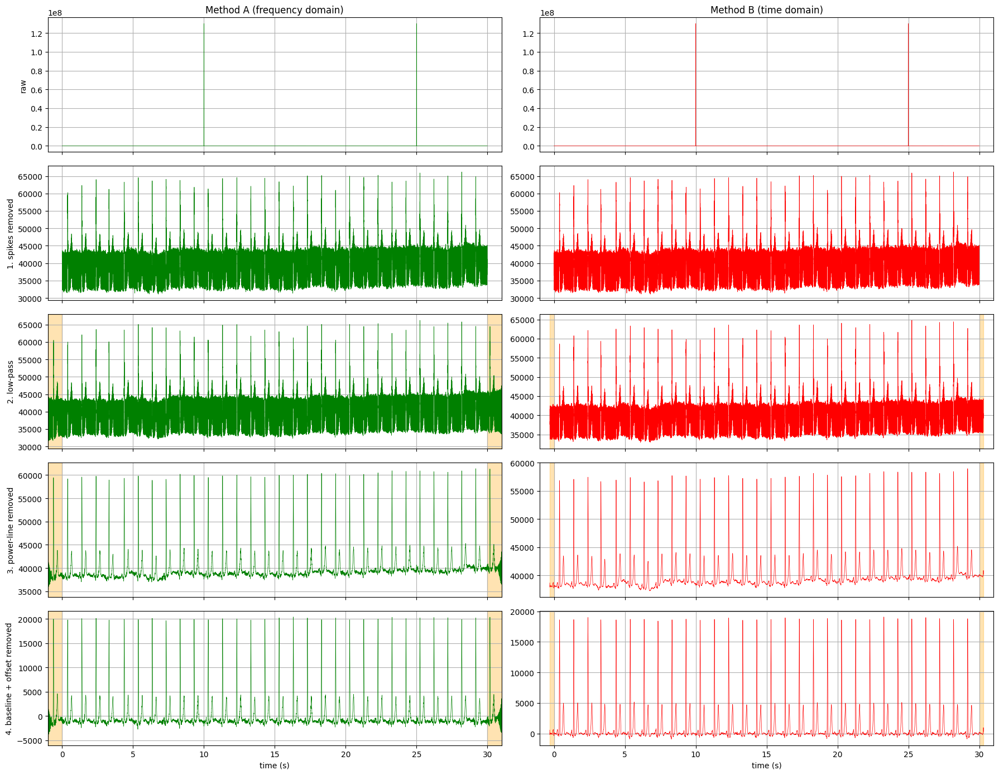

# ECG Signal Pre-processing

In this work, a 6-channel ECG recording is cleaned with the four standard pre-processing steps.
All code and explanations are found in **`ECG-processing.ipynb`**.



*Ch6 after every pre-processing step (raw, spikes removed, low-pass, power-line removed,
baseline and offset removed). Left: Method A (frequency domain). Right: Method B (time domain).
The orange areas are the padding, which is removed at the end.*

## Files

| File | Content |
|------|---------|
| `ecgConditioningExample.mat` | The original data: 6 ECG channels, 30 s, sampled at 1000 Hz (MATLAB v7.3 file) |
| `ECG-processing.ipynb` | The notebook (code, explanations and results) |
| `ECG-verification.ipynb` | Verification of the pre-processing (four simple tests, see below) |
| `ecgConditioningExample-processed.mat` | The processed signals (created by the notebook, see below) |
| `images/all_steps.png` | The figure of section 13 of the notebook (all steps, one after the other), shown above |

### Content of `ecgConditioningExample-processed.mat`

| Variable | Size | Content |
|----------|------|---------|
| `ecg_spike_removed` | 30000 x 6 | signals after step 1 (spike removal) |
| `ecg_method_a` | 30000 x 6 | final result of Method A (frequency domain) |
| `ecg_method_b` | 30000 x 6 | final result of Method B (time domain) |
| `fs` | 1 x 1 | sampling frequency (1000 Hz) |
| `connected` | 1 x 6 | 1 for a connected channel, 0 for a channel that is not connected (Ch4) |

As in the original file, every column is one channel. Ch4 (not connected) is saved as zeros.
The file can be opened in MATLAB with `load("ecgConditioningExample-processed.mat")`
or in Python with `scipy.io.loadmat`.

## How to run

The required libraries are installed with:

```bash
pip install numpy scipy matplotlib h5py jupyter
```

The notebook is opened with:

```bash
jupyter notebook ECG-processing.ipynb
```

The cells are then run from top to bottom with `Shift + Enter`.

## Content

1. Libraries
2. Import of the `.mat` file and check of the keys
3. Sampling frequency and Nyquist frequency
4. Check of the channels
5. Detection of a channel that is not connected
6. Fourier transform
7. The four kinds of ECG noise (BW, PLI, EMG, MA / EM)
8. **Step 1:** recording spike removal (percentile method and linear interpolation, explained in detail)
9. Kernel sizes (reason for every choice) and padding (size selected from the kernel size)
10. **Method A:** steps 2 to 4 in the frequency domain
11. **Method B:** steps 2 to 4 in the time domain
12. Removal of the padding
13. All steps, one after the other, shown for Ch6, and the effect of each single filter of steps 2 to 4 (before and after) for Method A and Method B
14. Comparison of the two methods
15. Long lead (whole 30 s) for every lead
16. Saving the cleaned signals (`ecgConditioningExample-processed.mat`)
17. Summary

| Pre-processing step | Method A (frequency domain) | Method B (time domain) |
|---|---|---|
| 1. Recording spike removal | more than 5 widths outside the 1st to 99th percentile range, replaced by linear interpolation between the samples before and after the spike | same |
| Padding (K/2 on each side) | 1000 samples (kernel: one wave of 0.5 Hz = 2000 samples) | 300 samples (kernel: 601-sample median filter) |
| 2. Low-pass filtering | frequencies above 100 Hz are deleted | average of 5 samples |
| 3. Power-line interference filtering | 50, 100, 150 ... Hz are deleted | average of 20 samples (one 50 Hz wave) |
| 4. Baseline wander and offset removal | frequencies below 0.5 Hz are deleted (0 Hz is the offset) | the mean and a median-filtered baseline are subtracted |

## Findings in this recording

| Channel | Problem found | Solution |
|---------|---------------|----------|
| Ch1 | large DC offset (about 16.75 million) | removed in step 4 |
| Ch3, Ch6 | recording spikes of 130 000 000 at 10 s (and at 25 s in Ch6) | removed in step 1 |
| Ch4 | all zeros, not connected | detected and skipped |
| all connected channels | strong 50 Hz power-line noise and its harmonics | removed in step 3 |

Almost the same ECG is produced by both methods.
In all connected leads, 30 regular beats at about 60 beats per minute are found.

## Verification

The pre-processing is checked in `ECG-verification.ipynb` with four simple tests. Every check gives PASS or FAIL, and all 31 checks pass.

| Test | What is checked | Result |
|------|-----------------|--------|
| 1. Data type | the original signal, `fs` and the saved results are double (`float64`), the saved results have size 30000 x 6, no NaN values | 8 / 8 |
| 2. Expected results | a test signal (30 beats with offset, baseline wander, 50 Hz noise and one spike) is cleaned: the spike is found, the offset is removed, the shape matches the clean ECG, all 30 beats are found | 7 / 7 |
| 3. Overall functionality | the saved result of the real recording: Ch4 only zeros, no spike left, 30 beats at about 60 per minute in every channel with both methods | 14 / 14 |
| 4. Computational time | both methods are faster than the 30 s signal | 2 / 2 |

## Choice of the kernel sizes

| Filter | Kernel size | Reason |
|--------|-------------|--------|
| Method B, low-pass (moving average) | 5 samples (5 ms) | reduces frequencies above about 90 Hz, similar to the 100 Hz cut of Method A, without flattening the QRS |
| Method B, power-line (moving average) | 20 samples (20 ms) | exactly one 50 Hz wave, so 50 Hz and all harmonics average to 0 |
| Method B, baseline (median filter) | 201 samples (200 ms) | removes the QRS complex and the P wave (about 80 to 100 ms) |
| Method B, baseline (median filter) | 601 samples (600 ms) | also removes the T wave (about 150 to 250 ms), still much shorter than the baseline wander |
| Method A, FFT filters | 2000 samples (2 s) | one wave of the lowest cut-off frequency (0.5 Hz); used to select the padding |

A median filter removes every wave that fills less than half of its window, because the median is the middle value of the sorted window. So the 600 ms filter removes the T wave (up to about 250 ms, shorter than 300 ms), while the slow baseline wander (3 to 5 s) is kept.

The padding on each side is half of the largest kernel: 1000 samples for Method A and 300 samples for Method B.
